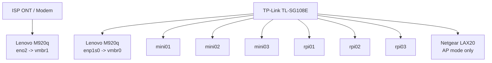
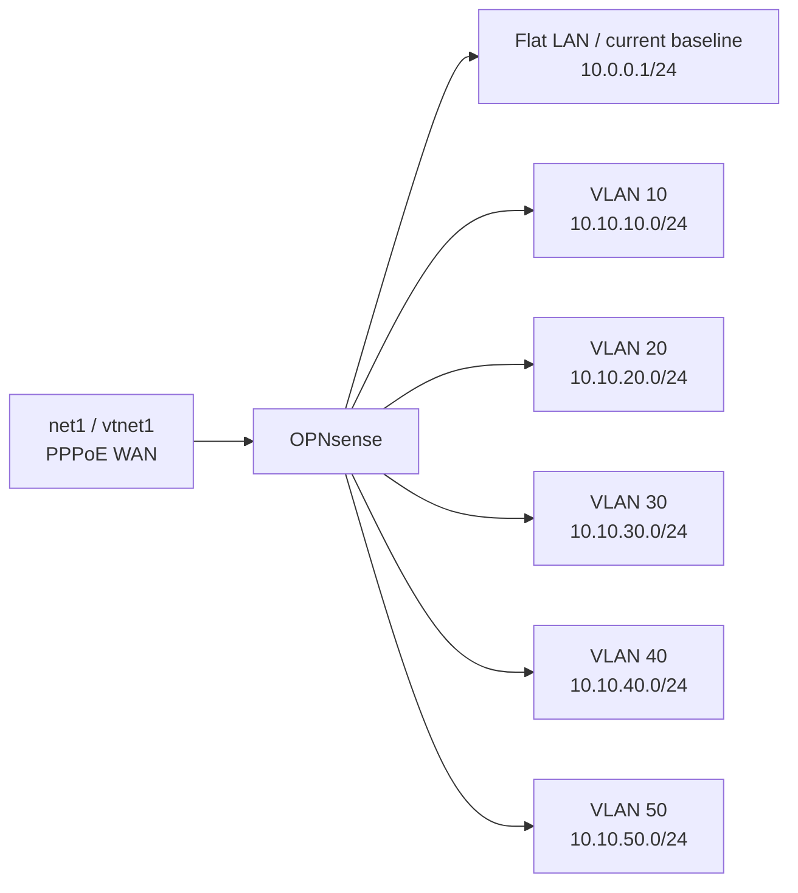

# Network Migration Plan

This plan replaces the abandoned single-NIC WAN-over-VLAN design.

## Final Design

- OPNsense runs on `pve01.homelab.internal`
- Proxmox uses two physical NIC paths:
  - `enp1s0` -> `vmbr0` for LAN trunking
  - `eno2` -> `vmbr1` for dedicated WAN handoff
- OPNsense uses two virtio NICs:
  - `net0` on `vmbr0` for bootstrap LAN plus VLAN trunking
  - `net1` on `vmbr1` for PPPoE WAN
- The TP-Link switch carries only LAN VLANs
- The Netgear LAX20 stays a flat AP on VLAN 40

## Current Stable Baseline

- OPNsense LAN / flat-LAN gateway: `10.0.0.1/24` with native IPv6 prefix tracked from WAN
- Proxmox management: `10.0.0.112/24`
- Netgear LAX20: AP-only, LAN-side uplink, DHCP disabled
- VLAN segmentation is deferred until a separate follow-on change window
- OPNsense WAN `Block private networks` must stay disabled for this ISP because the live PPPoE session presents an RFC1918 WAN address
- OPNsense WAN IPv6 dual-stack: The ISP delegates a dynamic `/64` prefix (`2001:db8:.../64`) over the PPPoE link via DHCPv6 (Basic mode, prefix delegation size `64`, prefix only enabled, send prefix hint enabled). LAN tracks WAN with prefix ID `0` via `Track Interface (legacy)`. Allow IPv6 is enabled in Firewall settings.

## Hard Constraint

The final design requires the ISP ONT/modem Ethernet handoff to terminate on the Lenovo WAN NIC path. Do not carry WAN through the TP-Link switch or a WAN VLAN.

If there is no permanent second physical path from the ONT location to the Lenovo WAN NIC, stop and add one before attempting final cutover.

## Final Physical Topology

## Final Logical Topology

## VLAN Plan

| VLAN | Name | Subnet | Purpose |
|------|------|--------|---------|
| 10 | management | `10.10.10.0/24` | Proxmox, OPNsense management, switch management |
| 20 | servers | `10.10.20.0/24` | HP minis, wired Pi service nodes, Synology later if moved |
| 30 | kubernetes | `10.10.30.0/24` | cluster-facing traffic where separation is required |
| 40 | clients | `10.10.40.0/24` | Netgear AP uplink and trusted client devices |
| 50 | iot | `10.10.50.0/24` | lower-trust devices |

## Switch Port Intent

| Port | Role | Mode | VLANs |
|------|------|------|-------|
| 1 | Lenovo `enp1s0` uplink | tagged trunk | `10,20,30,40,50` |
| 2 | mini01 | access | `20` |
| 3 | mini02 | access | `20` |
| 4 | mini03 | access | `20` |
| 5 | rpi01 | access | `20` |
| 6 | no WAN role in final design | unused or future access | none by default |
| 7 | Netgear LAX20 uplink | access | `40` |
| 8 | rpi02 | access | `20` |

`rpi03`, Synology, gaming PC, and the MacBook can be placed later based on the wall-run actually used. This design does not assume any unverified Netgear VLAN behavior.

## Proxmox Interface Model

### Bootstrap State

- `enp1s0` enslaved into `vmbr0`
- `vmbr0` has `10.0.0.112/24` with gateway `10.0.0.1`
- `eno2` enslaved into `vmbr1`
- `vmbr1` has no host IP

### Final State

- `vmbr0` stays VLAN-aware for `10,20,30,40,50`
- `vmbr0.10` has `10.10.10.10/24`
- gateway becomes `10.10.10.1`
- `vmbr1` remains IP-less and exists only for OPNsense WAN

## OPNsense Interface Model

### Phase A: Clean Bring-Up

- `vtnet0` = plain bootstrap LAN only
  - static `10.0.0.1/24`
  - IPv6 configuration type: `Track Interface (legacy)` tracking `WAN`, prefix ID `0`
- `vtnet1` = raw WAN parent
  - PPPoE runs directly on `vtnet1`
  - leave `Block private networks` disabled on WAN for this ISP
  - IPv6 configuration type: `DHCPv6` (Basic mode, prefix delegation size `64`, `Request prefix only`, `Send prefix hint`)
  - Note: In OPNsense 26.x, `dhcp6c` automatically binds to the PPPoE parent without manual selection.

No VLAN interfaces are required in this phase.

### Phase B: Segmentation After WAN Is Proven

- keep bootstrap LAN on `vtnet0` until the VLAN design is stable
- create VLAN interfaces on `vtnet0`
  - `vlan10` -> `10.10.10.1/24`
  - `vlan20` -> `10.10.20.1/24`
  - `vlan30` -> `10.10.30.1/24`
  - `vlan40` -> `10.10.40.1/24`
  - `vlan50` -> `10.10.50.1/24`
- move DHCP scopes to the VLAN interfaces
- leave bootstrap LAN in place until AP and Proxmox management cutover are both successful

## Build Order

1. Build Proxmox networking only:
   - `vmbr0` on `enp1s0`
   - `vmbr1` on `eno2`
2. Create a fresh OPNsense VM with:
   - `net0` on `vmbr0`
   - `net1` on `vmbr1`
3. Configure OPNsense for Phase A only:
   - bootstrap LAN on `vtnet0`
   - PPPoE on `vtnet1`
4. Validate WAN from local console while the ONT is physically on the Lenovo WAN NIC path
5. Only after Phase A works, add VLANs on `vtnet0`
6. Only after VLAN 10 works, move Proxmox management to `10.10.10.10`
7. Only after VLAN 40 works, move the Netgear uplink to access VLAN 40 and keep it in AP mode

## Stop Conditions

Stop and do not continue to the next phase if any of these are false:

- Proxmox console access works
- `vmbr1` exists with no host IP
- OPNsense flat LAN on `10.0.0.1` works
- PPPoE over `vtnet1` is confirmed with packet capture during offline cutover
- `vlan10` reachability works before moving Proxmox management

## Notes

- The old WAN VLAN `4090` design is retired.
- The TP-Link switch is not part of the permanent WAN path.
- The Netgear LAX20 is treated as a simple AP only.
- The current live network is intentionally flat on `10.0.0.0/24`; VLANs are a later phase.
